# 👋 你好，欢迎来到我的 GitHub！

  

  **AI 基础设施 | 大模型系统 | 昇腾 NPU | AI Agent**

  
  
  
  

---

# 📊 2026 年度开发者仪表盘

### 🏆 年度数据总览

<picture>
  <source media="(prefers-color-scheme: dark)" srcset="./assets/overview.dark.svg">
  
</picture>

### 📈 年度贡献趋势

<picture>
  <source media="(prefers-color-scheme: dark)" srcset="./assets/momentum.dark.svg">
  
</picture>

### 🧩 代码贡献组成

<picture>
  <source media="(prefers-color-scheme: dark)" srcset="./assets/composition.dark.svg">
  
</picture>

### ⏰ 开发活跃时间分布

<picture>
  <source media="(prefers-color-scheme: dark)" srcset="./assets/rhythm.dark.svg">
  
</picture>

### 💻 编程语言分布

<picture>
  <source media="(prefers-color-scheme: dark)" srcset="./assets/languages.dark.svg">
  
</picture>

### 🏅 活跃仓库排行榜

<picture>
  <source media="(prefers-color-scheme: dark)" srcset="./assets/repositories.dark.svg">
  
</picture>

### 🚀 项目成长时间线

<picture>
  <source media="(prefers-color-scheme: dark)" srcset="./assets/portfolio.dark.svg">
  
</picture>

---

# 🏆 GitHub 实时数据

  
  

---

# 🛠️ 技术栈

  

| 技术领域 | 核心技术 |
|---|---|
| AI 算子开发 | Ascend C、CANN、TileLang、CUDA |
| 高性能计算 | Kernel Optimization、Operator Fusion |
| 大模型系统 | LLM、MoE、Inference |
| Agent 工程 | AI Agent、Tool Calling、Claude Code |
| 开发工具 | Python、C/C++、Linux、Docker |

---

# 🚀 精选项目

| 项目 | 技术方向 | 核心亮点 |
|---|---|---|
| NPU MoE Fused Expert MLP | Ascend NPU / MoE | 端到端融合算子与性能优化 |
| 算子自动生成与性能演进 | AI Agent / Kernel | 自动生成、调试与优化 |
| CANNBot Skills | Agent Engineering | 算子开发自动化工作流 |
| LLM Agent 轨迹数据集 | LLM / Dataset | 工具调用与 Debug 轨迹构建 |

---

# 🎯 技术方向

`NPU Kernel` `MoE` `LLM Inference` `AI Agent` `Operator Fusion` `Automated Optimization`

---

  

  **让智能更高效，让工程持续进化。**

